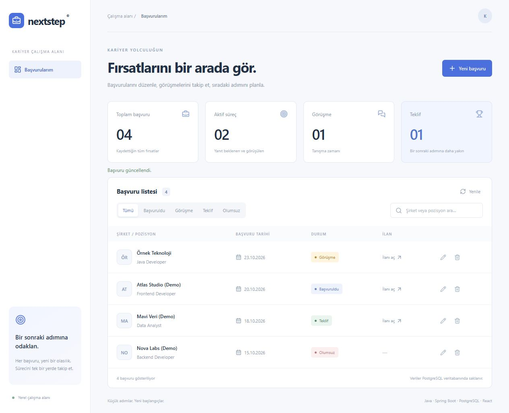

# Nextstep — Job Application Tracker

Java 17 + Spring Boot + PostgreSQL REST API with a React/TypeScript frontend.
Track company, position, listing URL, application date, notes and status:
Başvuruldu / Görüşme / Teklif / Olumsuz.



## Start the complete stack
Install Docker Desktop with Compose, then:
```sh
cp .env.example .env
# Windows PowerShell: Copy-Item .env.example .env
# Edit .env and replace DB_PASSWORD with your own local development password.
docker compose up --build
```
Open http://localhost:3000. The database persists in the `pgdata` volume.
`docker compose down` stops the stack while retaining data. Do not add `-v`
unless you intend to erase the database.

## Local development
Requirements: Java 17+, Maven 3.6+, Node 22.12+, PostgreSQL 17.
1. Start PostgreSQL (`docker compose up -d db` or your own instance).
2. Set `DB_PASSWORD` and optionally `DB_URL`, `DB_USER` in the backend shell.
   Default URL: `jdbc:postgresql://localhost:5432/applications`, user: `tracker`.
3. In `backend`: `mvn spring-boot:run`.
4. In `frontend`: `npm ci` then `npm run dev`.
Vite proxies `/api` to port 8080. Compose serves the built UI with nginx and the
same `/api` proxy. Flyway creates the schema; Hibernate validates it.

## Features
- Create, edit and delete applications; deletion asks for confirmation.
- Search company/position and filter by status; Turkish case handling.
- Total, active, interview and offer statistics calculated from real records.
- Loading, empty and API-error states; no fabricated default applications.
- Required field/date/URL validation on the backend and in the form.
- HTTP(S)-only listing links, length limits and safe rendered text.
- Optimistic locking rejects stale edits/deletions with HTTP 409.
- Database constraints and a status/date index; persistent volume in Compose.

## API
| Method | Path | Result |
|---|---|---|
| GET | `/api/applications` | All records, newest application date first |
| POST | `/api/applications` | Create; 201 |
| PUT | `/api/applications/{id}` | Replace editable fields; current `version` required |
| DELETE | `/api/applications/{id}?version=n` | Delete current version; 204 |

Example POST body:
```json
{"company":"Example Co","position":"Java Developer","url":"https://example.com/jobs","appliedOn":"2026-01-01","status":"APPLIED","notes":"Portfolio demo"}
```
Errors use `{"message":"..."}` with 400/404/409. Status changes are unrestricted
among the four states because a personal tracker may need retrospective corrections.

## Tests
```sh
cd backend
mvn test
cd ../frontend
npm ci
npm test
npm run build
```
Backend tests use H2 PostgreSQL compatibility by default; set `TEST_DB_URL`,
`TEST_DB_USER`, `TEST_DB_PASSWORD` to run them against a **disposable** PostgreSQL
database. Tests erase application rows in that test database. CI runs the same
API tests against PostgreSQL 17 and also builds/tests the frontend.
Tests cover CRUD, stale writes, invalid URLs, missing fields, future dates,
not-found responses, filters and statistics. Mockito is excluded because these
tests exercise real repositories without mocks.

## Deployment scope
Single-user local application, without authentication. Compose ports bind only
to 127.0.0.1. Add authentication, per-user ownership, pagination and backups before
public hosting or multi-user deployment. The Docker build is included; see
VERIFICATION.md for checks actually performed on this workstation.
